# Portfolio Assistant — Final Architecture

The single reference for the portfolio chatbot: how it's built, **why each choice was made**
(including the tools we deliberately did *not* use: LangChain, LangGraph, Pinecone, Chroma,
MCP at runtime, an eval harness), its contracts, known gaps, and how to operate it.

Wider platform: [hld-architecture.md](./hld-architecture.md).

**Contents:** 1 Summary · 2 Scope · 3 Components · 4 Diagram · 5 Request lifecycle ·
6 Knowledge pipeline · 7 Tools & MCP · 8 Technology choices · 9 Evals · 10 Security ·
11 Contracts · 12 Known gaps · 13 Roadmap · 14 Operations · 15 Interview cheat-sheet

---

## 1. One-paragraph summary

A **scoped RAG assistant** that only answers questions about Dival's portfolio, experience,
projects, skills, blog posts, and the contact flow. The UI is a client-only React widget in the
Next.js app. All AI work runs in **one Cloudflare Worker** (~270 lines of TypeScript) that uses
**Workers AI** for embeddings (`bge-base-en-v1.5`) and generation
(`llama-3.3-70b-instruct-fp8-fast`), **Vectorize** as the vector store, and **KV** for
sessions, rate limits, and daily counters. The knowledge base is rebuilt from a Next.js
endpoint (`/api/chat-context`, fed by Contentful + portfolio JSON) on every deploy, every
Contentful publish, and once a day by cron. The only "tool" the model can trigger is
**sending a contact message**, and the Worker, not the model, decides whether it is actually
sent.

---

## 2. Scope

**Allowed:** Dival's portfolio website; career, roles, companies; projects and stack; skills;
published blog posts and summaries; contacting or hiring Dival. Short follow-ups ("explain
this", "why?") are allowed after an in-scope turn or while viewing a `/blogs/<slug>` page.

**Rejected:** general coding help unrelated to Dival's work; news, finance, politics, homework,
entertainment, personal advice; requests to reveal prompts, retrieved text, session content,
secrets, or internal tokens; requests to act as a general-purpose chatbot.

**Answer policy:** concise and professional; tailored to the actual question rather than one
generic intro; no invented employers, projects, dates, skills, links, or blog claims; an honest
"not enough verified context" fallback when the index doesn't support an answer.

**Non-goals:** general chat, authenticated user accounts, multi-language answers.

---

## 3. Components

| Layer | File | Responsibility |
|---|---|---|
| Mount | [Providers/index.tsx](../apps/web/src/components/Providers/index.tsx) | `dynamic(..., { ssr: false })`, keeps the widget out of SSR and LCP |
| UI | [Chatbot/index.tsx](../apps/web/src/components/Chatbot/index.tsx), `ChatPanel/*` | Toggle, header, messages, composer, empty state, typing indicator |
| UI state | [useChat.ts](../apps/web/src/components/Chatbot/hooks/useChat.ts) | History load, send, SSE parse, abort, clear |
| Context API | [api/chat-context/route.ts](../apps/web/src/app/api/chat-context/route.ts) | Profile (Contentful) + portfolio JSON + recent blogs for seeding |
| Worker entry | [worker/index.ts](../apps/web/src/worker/index.ts) | `/api/chat`, `/api/history`, `/api/health`, cron, prompt, completion |
| Guardrails | [worker/guards.ts](../apps/web/src/worker/guards.ts) | Scope gate, input/output patterns, contact token + validation |
| Retrieval | [worker/retrieval.ts](../apps/web/src/worker/retrieval.ts) | Follow-up query rewrite, embed, Vectorize query, threshold |
| Seeding | [worker/seed.ts](../apps/web/src/worker/seed.ts) | `/api/seed`, `runSeed`, chunking, CORS, purge + upsert |
| Chunk helper | [worker/sentences.ts](../apps/web/src/worker/sentences.ts) | Linear-time sentence splitter |
| Types | [worker/types.ts](../apps/web/src/worker/types.ts) | `Env`, `ChatSession`, `ChatMessage` |
| Seed CLI | [scripts/seed-chatbot.mjs](../apps/web/scripts/seed-chatbot.mjs) | Manual / CI authenticated reseed |
| Infra | [wrangler.json](../apps/web/wrangler.json) | AI, Vectorize, KV bindings; vars; cron |
| CI | [.github/workflows/chatbot.yml](../.github/workflows/chatbot.yml) | Deploy Worker + reseed after Vercel production deploy |

**Cloudflare bindings:** `AI` (Workers AI: `@cf/baai/bge-base-en-v1.5`,
`@cf/meta/llama-3.3-70b-instruct-fp8-fast`), `VECTORIZE` (index `faq-vectors`),
`CHAT_SESSIONS` (KV).

---

## 4. System diagram

```mermaid
flowchart LR
    subgraph Browser
        W["Chatbot widget<br/>(dynamic, ssr:false)"]
        H["useChat hook<br/>SSE parse · abort · history"]
    end

    subgraph Vercel["Next.js on Vercel"]
        CTX["/api/chat-context<br/>profile + portfolio + blogs"]
        CON["/api/contact"]
        REV["/api/revalidate<br/>(Contentful webhook)"]
        CMS[(Contentful)]
    end

    subgraph Worker["Cloudflare Worker: ai-chatbot-widget"]
        CHAT["/api/chat"]
        HIST["/api/history"]
        SEED["/api/seed (Bearer)"]
        CRON["cron 03:00 UTC"]
    end

    subgraph CF["Cloudflare platform"]
        EMB["Workers AI<br/>bge-base-en-v1.5"]
        LLM["Workers AI<br/>llama-3.3-70b fp8-fast"]
        VEC[(Vectorize<br/>faq-vectors)]
        KV[(KV<br/>CHAT_SESSIONS)]
    end

    GH["GitHub Actions<br/>chatbot.yml"]

    W --> H -->|POST message + pagePath| CHAT
    H -->|GET| HIST
    CHAT --> EMB --> VEC
    CHAT --> LLM
    CHAT <--> KV
    HIST <--> KV
    CHAT -->|contact tool| CON
    CMS --> CTX
    CMS -.publish.-> REV -.-> SEED
    GH -->|deploy + reseed| SEED
    CRON --> SEED
    SEED --> CTX
    SEED --> EMB
    SEED -->|purge + upsert| VEC
```



---

## 5. Request lifecycle (`POST /api/chat`)

Code: [apps/web/src/worker/index.ts](../apps/web/src/worker/index.ts)

| # | Step | Deterministic or model? | Code |
|---|---|---|---|
| 1 | Parse JSON, reject empty | code | `readChatPayload` |
| 2 | Input guardrails: blocked topics, prompt-extraction regexes, 500-char cap | code | `validateMessage` in [guards.ts](../apps/web/src/worker/guards.ts) |
| 3 | Rate limit: 20 req / 60 s per IP (KV counter) | code | `isRateLimited` |
| 4 | Load or mint session from `HttpOnly` cookie | code | `chat` |
| 5 | Scope gate: portfolio terms, greetings, or follow-ups with recent context or an active `/blogs/<slug>` page | code | `isInPortfolioScope` |
| 6 | Retrieval: rewrite short follow-ups with the previous user turn, embed, Vectorize `topK=5`, keep `score ≥ 0.65` | code + embedding model | `faq` in [retrieval.ts](../apps/web/src/worker/retrieval.ts) |
| 7 | Prompt: policy prompt + retrieved facts labelled *untrusted data* + last 10 turns | code | `SYS` |
| 8 | Generate: `max_tokens 500`, `temperature 0.35`, repetition/frequency penalties | **model** | `runCompletion` |
| 9 | Output guardrails: leak-pattern filter, extract + validate contact tool call, execute it | code | `postProcessReply` |
| 10 | Persist session (7-day TTL), reply as SSE | code | `chatStream` |

Only step 8 is non-deterministic. Every security boundary (scope, secrets, rate limits,
contact submission) is enforced in code around the model, so a jailbroken model still can't
get past them.

---

## 6. Knowledge pipeline (indexing)

Code: [apps/web/src/worker/seed.ts](../apps/web/src/worker/seed.ts),
[apps/web/src/app/api/chat-context/route.ts](../apps/web/src/app/api/chat-context/route.ts)

1. **Source of truth:** `/api/chat-context` returns the translated profile copy from Contentful,
   experience/projects from portfolio JSON, and recent blog posts.
2. **Chunking:** one chunk each for general, about, experience summary, and contact; one per
   role and per project; blog bodies are packed **by sentence** into ≤1400-char chunks
   (max 8 per post), so an embedding never starts or ends mid-sentence.
3. **Embedding:** `bge-base-en-v1.5` (768-dim), batches of 50.
4. **Idempotent upsert:** deterministic IDs (`blog-3-1`, `proj-2`, …). Before every upsert the
   Worker deletes all managed IDs (in batches of 100) so stale or shortened content can't
   linger in results.
5. **Triggers:**
   - push to `main` → [.github/workflows/chatbot.yml](../.github/workflows/chatbot.yml) waits for
     the Vercel deploy, redeploys the Worker, reseeds
   - Contentful publish → `/api/revalidate` → authenticated `/api/seed`
   - daily cron `0 3 * * *` (safety net, needs no secret)
   - manual: `yarn workspace web seed`

---

## 7. Tools and MCP: where they are and where they aren't

### 7.1 The one runtime tool: `submit_contact`

The assistant has exactly one side-effecting capability: forwarding a message to Dival.

- The prompt tells the model to collect **name, email, and message**, confirm them with the
  user, and only then emit `[SUBMIT_CONTACT: {"name":…,"email":…,"message":…}]`.
- The Worker (`stripContactToken` → `validateContact` → `submitContact`) strips the token so it
  never reaches the browser, validates every field (name ≤120, email shape ≤254, message
  ≤1000), and `POST`s to the Next.js `/api/contact` route (the same backend as the site's
  contact form).
- The user sees a **fixed success or failure message** based on the real HTTP result, never
  the model's own claim that the message was sent.

**Why a text token instead of native function calling?** It works the same way on any chat
model, including models served without reliable tool-call support. With a single tool there's
no tool *selection* to get wrong, and the safety-critical parts (validation, the confirm step,
reporting the real outcome) are in code either way. If the toolset grows (see 7.3), switching
to native `tools` / JSON-schema function calling is a contained change in `runCompletion` and
`postProcessReply`.

### 7.2 MCP: used at development time, not at runtime

| Where | MCP? | What for |
|---|---|---|
| Authoring (Claude Code / VS Code) | **Yes**: `@contentful/mcp-server` via `.mcp.json` / `.vscode/mcp.json` (git-ignored, holds a management token) | Drafting and publishing blog entries in Contentful from the editor; the [blog writing prompt](./contentful/blog-writing-prompt.md) runs through it |
| Chatbot Worker | **No** | — |

Publishing through that MCP feeds the chatbot indirectly: a Contentful publish fires the
revalidation webhook, which reseeds Vectorize, so a post written through MCP becomes
answerable in the chat within minutes.

**Why no MCP server inside the chatbot?** MCP is a protocol for exposing tools to an *agent
host* (Claude Desktop, IDEs, agent frameworks) that discovers and calls them at runtime. Our
Worker is both the host and the only consumer, and it has one tool. Wrapping `submit_contact`
in an MCP server would add a network hop, a transport, and an auth surface without giving us
any capability we lack.

### 7.3 When we *would* add MCP

- **Expose the portfolio as an MCP server** (`search_portfolio`, `get_blog_post`,
  `send_contact`) so external agents (a recruiter's Claude, an IDE) can query Dival's work
  directly. This is the most compelling case: same Vectorize index, new consumers.
- **Consume MCP servers** if the assistant needs several third-party systems (calendar booking
  via a Calendly/Google MCP, GitHub repo stats), where reusing existing servers beats writing
  integrations.

---

## 8. Technology choices and alternatives

### 8.1 Orchestration: plain TypeScript, not LangChain or LangGraph

The whole pipeline is a **fixed, linear sequence**: validate → scope → retrieve → generate →
post-process. There are no loops, no branching between agents, and no multi-step planning.

| | LangChain | LangGraph | Our Worker |
|---|---|---|---|
| Model | Chains / LCEL pipelines, many integrations | Stateful **graph** of nodes with cycles, checkpoints, human-in-the-loop | ~270 lines of TS, 4 small modules |
| Good at | Quickly wiring standard RAG from parts | Agents that loop (plan → act → observe → retry), multi-agent handoffs, resumable long-running flows | Exactly one deterministic pipeline |
| Cost here | Bundle size and Node-API assumptions on the Workers runtime; abstraction over 2 API calls | Graph runtime and checkpointer for a flow with no cycles | None |
| Debuggability | Through framework layers | Through graph state | Every step is a named function with unit tests |

**LangChain vs LangGraph, in one line:** LangChain composes a **DAG** (a pipeline that runs
forward once); LangGraph adds **cycles and persistent state**, which an agent needs to decide,
act, inspect the result, and loop. LangGraph is the right pick once the assistant has to
*reason over multiple tool calls*. For example: "check Dival's availability, propose three
slots, wait for the user to pick, book it, and on failure re-plan." That flow has loops,
waiting states, and recovery, which is what a graph with checkpoints is for. Our flow has none,
so either framework would be overhead.

**Why not LangChain just for RAG plumbing?** Our RAG plumbing is one `AI.run` for the
embedding, one `VECTORIZE.query`, and one `AI.run` for the answer. Native bindings give
typed, zero-network-hop access to all three. A framework would wrap two calls and make the
guardrail ordering (our main differentiator) less explicit.

### 8.2 Vector store: Cloudflare Vectorize, not Pinecone or Chroma

| | **Vectorize** (chosen) | Pinecone | Chroma |
|---|---|---|---|
| Hosting | Same platform as the Worker; accessed via a **binding**, no API key, no egress | Managed SaaS, separate account, API key, cross-provider network hop | Self-hosted (or Chroma Cloud): needs a server/container to run |
| Fit for our size (~100 vectors) | Free tier covers it many times over | Excellent but built for millions+; free tier has its own limits | Great locally; running a server for 100 vectors is overkill |
| Runs inside a Worker | Native | HTTP client | No embedded mode in Workers (Chroma's in-process mode is Python/Node with a filesystem) |
| Features we'd miss | Metadata filtering is basic; no built-in hybrid/keyword search | Hybrid search, namespaces, rerankers | Rich local dev ergonomics, open source |
| Secrets to manage | 0 | 1 (API key) | Server + auth |

**When we'd switch:**
- **Pinecone:** if the corpus grew to large multi-tenant data, or we needed managed hybrid
  (sparse + dense) search and reranking for exact-name queries.
- **Chroma:** for local experimentation or a Python notebook to tune chunking and thresholds
  offline. It's a good *development* store; for this deployment it would mean running a server.
- **pgvector:** if we already had Postgres holding relational data we wanted to join with vectors.

### 8.3 Models: Workers AI

- **Generation:** `@cf/meta/llama-3.3-70b-instruct-fp8-fast`. A 70B open model is strong enough
  for grounded summarisation, the fp8 "fast" variant keeps latency acceptable, and it replaced
  `llama-3-8b-instruct` before that model's **2026-05-30 deprecation**.
- **Embeddings:** `@cf/baai/bge-base-en-v1.5` (768-dim), a solid English retrieval model on the
  same platform. Changing it means **re-embedding the whole index**, since dimensions must match.
- **Why not OpenAI / Anthropic APIs?** Same platform, no external key, no egress, and the free
  tier covers a portfolio's traffic. The cost is quality headroom: a frontier model would
  follow the contact protocol and refusals more reliably. Because the model call is isolated in
  `runCompletion`, swapping providers is a one-function change.
- **Generation settings:** `temperature 0.35` lets wording vary a little without encouraging
  invented facts; repetition and frequency penalties stop the same intro from repeating.

### 8.4 State: KV

KV holds sessions (7-day TTL), per-IP rate-limit counters (120 s TTL), and daily request
counts. It's a zero-ops store already bound to the Worker. **Known trade-off:** KV is
eventually consistent and `get → +1 → put` isn't atomic, so the rate limit is best-effort.
The fix is Cloudflare Rate Limiting rules or a **Durable Object** per IP or session (see the
§12).

### 8.5 Delivery: SSE contract, single completion

Every reply (model, refusal, rate-limit, or contact result) uses the same SSE shape, so the
client has one code path. The model call itself is **non-streaming**, because the streaming
variant returned empty bodies on the current runtime. The contract already supports true
token streaming, so turning it back on is a server-only change.

---

## 9. Evals: why there's no eval harness yet, and what covers the gap

### 9.1 What we have instead

| Layer | What it guarantees | Where |
|---|---|---|
| Unit tests on guardrails | Scope gate, prompt-extraction blocking, blog-path sanitising, contact token parsing and validation, message limits | [guards.test.ts](../apps/web/src/worker/guards.test.ts) |
| Unit tests on retrieval | Score threshold filtering, follow-up query rewriting, failure → empty context | [retrieval.test.ts](../apps/web/src/worker/retrieval.test.ts) |
| Unit tests on chunking | Sentence splitting matches the old regex, stays linear (no ReDoS) | [sentences.test.ts](../apps/web/src/worker/sentences.test.ts) |
| Client tests | SSE parsing, abort, history, error states | [useChat.test.ts](../apps/web/src/components/Chatbot/hooks/useChat.test.ts) |
| Deterministic boundaries | Anything safety-critical is code, so it's testable with normal unit tests | §5 |
| Manual smoke checklist | Portfolio Q, blog follow-up, missing fact, contact, off-topic, prompt leak, unauthorised seed | §14.3 |

### 9.2 Why we didn't build evals (yet)

1. **The risky parts aren't model behaviour.** We moved scope, secrets, rate limiting, and the
   contact side effect into deterministic code, which ordinary unit tests verify more cheaply
   and more reliably than LLM evals.
2. **Small, closed domain.** About 100 chunks about one person. Hallucination risk is limited
   by a high retrieval threshold, a "not enough verified context" fallback, and a grounding-only
   prompt.
3. **No baseline to compare against.** Evals pay off when you're *choosing between* prompts,
   models, chunking strategies, or retrievers. We shipped one configuration and haven't changed
   models since the forced deprecation migration.
4. **Cost and ownership.** An LLM-as-judge suite runs a model on every CI run and needs a
   curated golden set and someone to keep it up to date. For a portfolio, that overhead was
   larger than the risk it would catch.

### 9.3 What evals we'd add, and when

Trigger: the next **model swap, embedding change, or prompt rewrite**, since those are the
changes unit tests can't judge.

| Eval | Metric | How |
|---|---|---|
| Retrieval | Recall@5, MRR on ~40 labelled question → expected-chunk-ID pairs | Pure code against a frozen seed snapshot; cheap, runs in CI |
| Groundedness / faithfulness | Fraction of answer claims supported by retrieved context | LLM-as-judge (or RAGAS-style faithfulness) |
| Answer relevance | Does the answer address the question | LLM-as-judge with a rubric |
| Refusal accuracy | Off-topic → refused; in-scope → not refused (precision/recall) | Labelled set; mostly deterministic |
| Red-team / injection | Leak rate on a prompt-injection corpus, including injected text inside blog content | Corpus + leak-pattern checks |
| Contact tool | Token emitted only after confirmation; correct field extraction | Scripted multi-turn conversations |

Online signals to add alongside: refusal rate, fallback rate, empty-completion rate, retrieval
score distribution, contact success rate (Workers Analytics Engine, no raw message logging).

---

## 10. Security model (summary)

- **Input:** length cap, blocked topics, regexes for prompt-extraction and injection attempts.
- **Scope gate in code**, not only in the prompt. Retrieved text is **never** used to decide
  whether a question is in scope, which closes off injection via indexed content.
- **Prompt:** retrieved facts are explicitly labelled untrusted data, never instructions.
- **Output:** leak-pattern filter; the internal contact token is always stripped.
- **Tool safety:** validation, a confirm-before-send step, and only the real outcome reported.
- **Seeding:** Bearer `SEED_SECRET`; source URL is server-configured (no caller-supplied URL,
  so no SSRF and no arbitrary re-indexing).
- **Transport:** CORS allowlist; `HttpOnly; Secure; SameSite=None` session cookie in production.
- **Open items:** edge WAF / Turnstile, atomic rate limiting, 7-day PII retention review
  (§12).

---

## 11. Contracts

### 11.1 Worker HTTP surface

| Route | Method | Auth | Request | Response |
|---|---|---|---|---|
| `/api/chat` | POST | session cookie (optional) | `{ message, pagePath? }` | SSE `text/event-stream` |
| `/api/history` | GET | session cookie | — | `{ messages: ChatMessage[] }` |
| `/api/seed` | POST | `Bearer SEED_SECRET` | — | `{ success, count }` |
| `/api/health` | GET | none | — | `{ status: "ok" }` |

### 11.2 SSE shape (every reply: model, refusal, rate limit, contact result)

```text
data: {"response":"<text>"}

data: [DONE]
```

### 11.3 KV keys (`CHAT_SESSIONS`)

| Key | Value | TTL |
|---|---|---|
| `sess_<uuid>` | `ChatSession` JSON | 7 days |
| `rate:<ip>:<minute-bucket>` | counter | 120 s |
| `stats:chat:<YYYY-MM-DD>` | daily counter | none |

---

## 12. Known gaps

**High**
1. **KV rate limiting isn't atomic.** `get → +1 → put` races under concurrency and KV is
   eventually consistent, so bursts can exceed 20/min.
2. **No edge WAF / bot protection.** `/api/chat` and `/api/seed` rely on app-level checks; a
   determined caller can drive Workers AI cost.
3. **Partial Worker test coverage, no evals.** Guardrails, retrieval, and chunking are tested;
   the request handler, leak filter, seed auth, and stale-vector purge aren't (see §9).

**Medium**
4. **Not true streaming.** One buffered completion sent over SSE; time to first byte equals full
   generation time.
5. **Substring scope gate.** False positives ("reactor", "contactless") and misses for legitimate
   rephrasings.
6. **Naive blocked-word list.** Blocks "cryptography", and is bypassed with spacing or synonyms.
7. **7-day PII retention.** Sessions may hold names and emails from the contact flow.
8. **`pagePath` is attacker-controlled.** Only `/blogs/<slug>` is accepted, but the slug still
   flows into the embedding query.

**Low**
9. The 0.65 similarity threshold is a magic number with no tuning telemetry.
10. No quality metrics; inference errors only go to `console.error`.
11. Message list isn't virtualized or persisted client-side.
12. Worker and site URLs are hard-coded in several files.
13. Rapid content replacement can be noisy for screen readers despite `aria-live`.

---

## 13. Roadmap and scaling path

| If… | Then |
|---|---|
| Traffic or abuse grows | Cloudflare Rate Limiting + Turnstile; Durable Objects for atomic per-session state |
| Answers to exact-name queries miss | Hybrid search (keyword + vector) or a reranker; consider Pinecone |
| Assistant needs multi-step actions (booking, follow-ups) | Native function calling → **LangGraph** for loops, waiting states, checkpoints |
| External agents should query the portfolio | Publish an **MCP server** over the same Vectorize index |
| Prompt/model changes become frequent | Add the eval suite from §9.3 as a CI gate |
| Perceived latency matters | Re-enable token streaming (the SSE contract already supports it) |

Smaller items: citations (show the source blog slug), a daily per-IP abuse budget,
config-driven thresholds, `sessionStorage` for instant reopen, stop/retry controls, markdown
rendering, a shorter session TTL, and a server-side "clear my data" endpoint.

---

## 14. Operations

### 14.1 Configuration

| Variable | Where | Purpose |
|---|---|---|
| `NEXT_PUBLIC_CHATBOT_URL` | Next.js | Worker base URL used by the client |
| `CHATBOT_SEED_SECRET` | Next.js + GitHub repo secret | Bearer for revalidation and CI reseed |
| `REVALIDATION_SECRET` | Next.js | Contentful webhook auth |
| `SEED_SECRET` | Worker secret (`yarn wrangler secret put SEED_SECRET` in `apps/web`) | Auth for `/api/seed`; **must equal** `CHATBOT_SEED_SECRET` |
| `CHAT_CONTEXT_URL` | Worker var | Seeding source (`https://divalsehgal.vercel.app/api/chat-context`) |
| `CONTACT_API_URL` | Worker var | Contact target (`https://divalsehgal.vercel.app/api/contact`) |
| `CLOUDFLARE_API_TOKEN`, `CLOUDFLARE_ACCOUNT_ID` | GitHub repo secrets (optional) | Let CI run `wrangler deploy`; without them CI only reseeds |

A mismatch between `SEED_SECRET` and `CHATBOT_SEED_SECRET` silently breaks auto-reseed with a 401.

### 14.2 Commands

```bash
yarn workspace web worker:deploy
```

```bash
yarn workspace web seed
```

```bash
yarn workspace web worker:tail
```

```bash
curl -X POST https://ai-chatbot-widget.sehgaldival.workers.dev/api/seed -H "Authorization: Bearer $CHATBOT_SEED_SECRET"
```

Health: `GET /api/health` → `{ "status": "ok" }`. Confirm the daily `0 3 * * *` reseed in
Cloudflare observability.

### 14.3 Release smoke test

Ask one portfolio question, one active-blog follow-up, one missing-fact question, one contact
request (through to submission), one off-topic request, and one prompt-leak attempt; send one
unauthenticated `/api/seed` (expect 401).

### 14.4 When you change X, also do Y

| Change | Follow-up |
|---|---|
| Portfolio JSON / blog shape | Update `Portfolio` / `Blog` interfaces in `seed.ts`; reseed |
| Vector ID scheme | Extend `getManagedVectorIds` so old IDs are purged |
| Generation model | Update `runCompletion`; check the output shape (`response` vs `choices`); note the deprecation date |
| Embedding model | **Re-seed the whole index** (dimensions must match) |
| Prompt (`SYS`) | Re-run guardrail tests and the smoke test; watch for scope drift |
| Allowed origins | Update `configuredOrigins` in `getCorsHeaders` |
| Scope / blocked lists | Add tests for the new terms; watch for substring false positives |

### 14.5 Runbook

| Symptom | Likely cause | Action |
|---|---|---|
| Every answer is the fallback line | Empty retrieval or empty completion | Check reseed `count`, model name, `VECTORIZE` binding |
| Auto-reseed stopped | Secret mismatch | Re-sync `SEED_SECRET` / `CHATBOT_SEED_SECRET` |
| CORS errors | Origin not allowlisted | Add it to `configuredOrigins` |
| History not loading | Cross-site cookie blocked | Check `SameSite=None; Secure` over HTTPS |
| `Cannot set properties of undefined (setting '#options')` | `env.AI.run` called detached | Keep `env.AI.run.bind(env.AI)` |
| Rising refusal or fallback rate | Scope gate or retrieval regressed | Inspect recent changes to terms, threshold, seed |
| Seed `count` drops | Context API or Contentful fetch broken | Hit `/api/chat-context` directly |
| Cost spike | Abuse, no edge limit | Enable Cloudflare Rate Limiting + Turnstile |

### 14.6 Dependency hygiene

- Track [Workers AI model deprecations](https://developers.cloudflare.com/changelog/post/2026-05-08-planned-model-deprecations/);
  see the [Llama 3.3 70B fast model page](https://developers.cloudflare.com/workers-ai/models/llama-3.3-70b-instruct-fp8-fast/)
  and the [Vectorize binding API](https://developers.cloudflare.com/vectorize/reference/client-api/).
- `compatibility_date` is pinned to `2025-12-23`; review it on upgrades.

### 14.7 Open questions

- Should history be client-owned (privacy) rather than KV-owned (UX)?
- Hybrid (keyword + vector) search for exact-name queries?
- What monthly Workers AI budget is acceptable, and what caps enforce it?

---

## 15. Interview cheat-sheet

**"Walk me through the architecture."**
A Next.js widget talks to one Cloudflare Worker. The Worker validates and scope-gates the
message in code, embeds it with bge-base, retrieves the top 5 chunks from Vectorize above a 0.65
threshold, sends a grounded prompt to Llama 3.3 70B on Workers AI, filters the output, runs the
contact tool if requested, stores the session in KV, and replies over SSE. The index is rebuilt
from Contentful on every deploy, every publish, and daily.

**"Why not LangChain?"**
The pipeline is linear and only two model calls long. Native bindings are typed, run on the same
platform, and keep the guardrail order explicit and unit-testable. A framework would wrap two
calls and add bundle weight to an edge runtime.

**"LangGraph vs LangChain?"**
LangChain composes forward-only pipelines; LangGraph models an agent as a stateful graph with
cycles, checkpoints, and human-in-the-loop. I'd reach for LangGraph when the assistant has to
loop over tool results, for example availability → propose → wait → book → retry on failure.
We don't have that loop today, so we use neither.

**"Why Vectorize over Pinecone or Chroma?"**
About 100 vectors, same platform as the compute, accessed through a binding with no API key or
egress, and free at this scale. Pinecone wins at large scale and for hybrid search; Chroma is
excellent for local experiments but would mean running a server here.

**"Where are MCP and tools?"**
At runtime there's one tool, `submit_contact`. The model emits a structured token after the user
confirms, and the Worker validates it, calls `/api/contact`, and reports the real result. MCP is
used at authoring time: the Contentful MCP server lets me write and publish posts from the
editor, and publishing reseeds the chatbot automatically. I didn't put MCP inside the chatbot
because the Worker is both the host and the only consumer. The natural next step is to *expose*
the portfolio as an MCP server for external agents.

**"Why no evals?"**
I moved the high-risk behaviour (scope, secrets, rate limits, the contact side effect) into
deterministic code with unit tests, so evals would mostly have measured wording quality on a
roughly 100-chunk single-person corpus with one fixed configuration. Evals earn their cost when
you're comparing configurations. My plan is retrieval recall@k plus faithfulness and refusal
evals, gated in CI, starting with the next model or prompt change.

**"What would you improve first?"**
1. Atomic, edge-level rate limiting (Durable Objects / WAF), because cost abuse is the real risk.
2. The retrieval eval set, so tuning the threshold and chunk size is data-driven.
3. Real token streaming for latency.
4. Swap the substring scope gate for an embedding-similarity classifier, which has fewer false
   positives such as "reactor".

---

*Last reviewed: 2026-10-09.*
